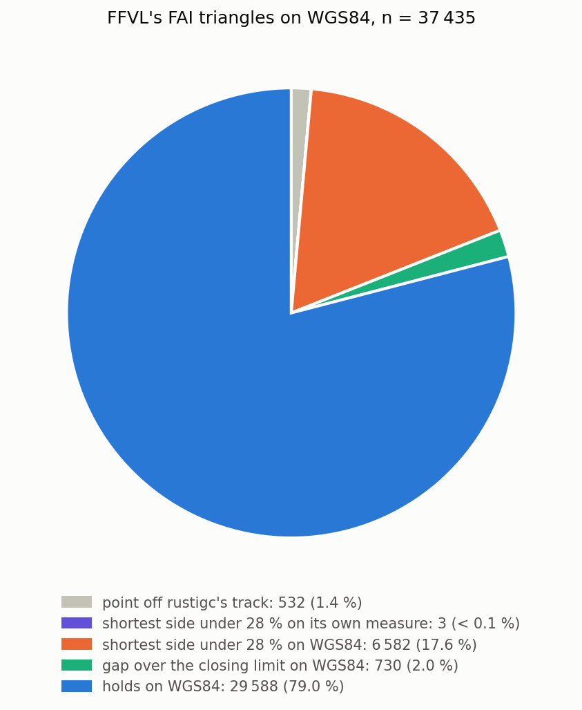
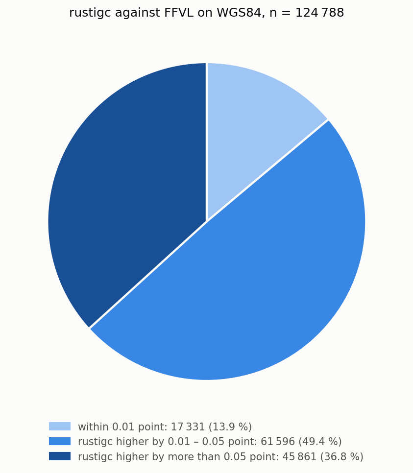
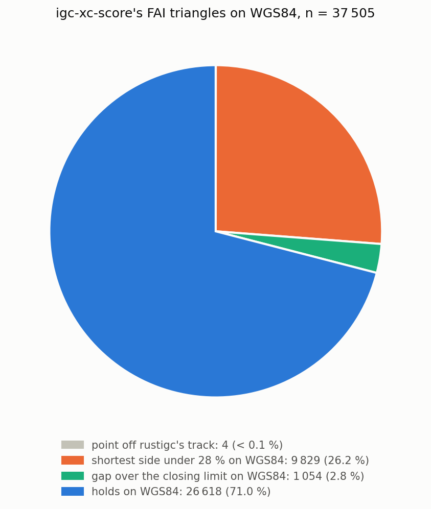
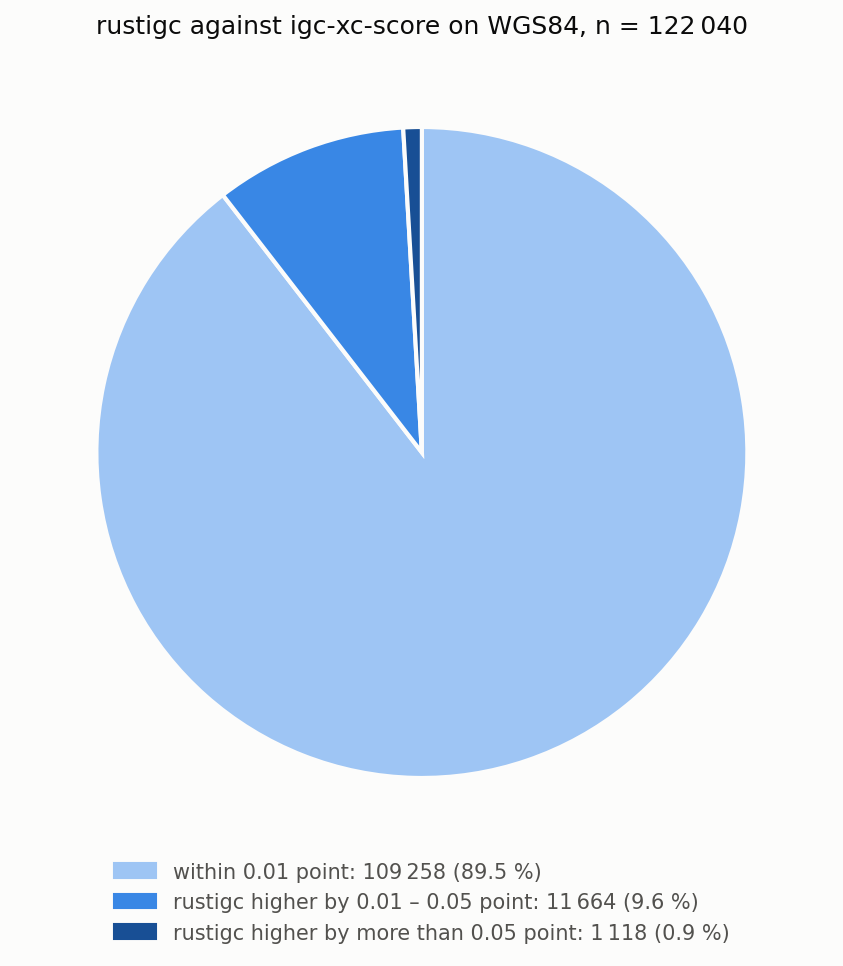
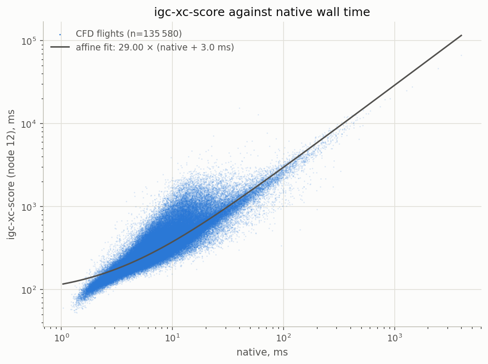
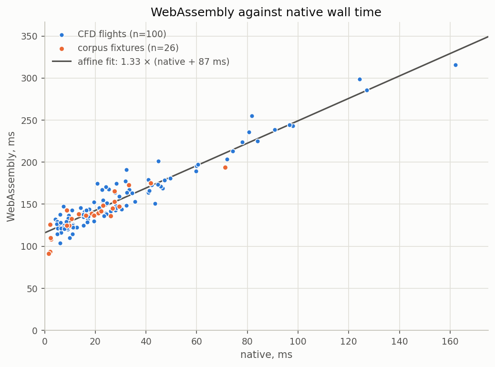
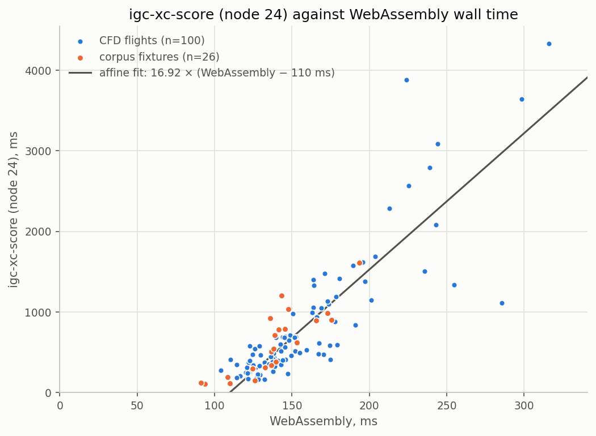

# Scoring a cross-country flight

Score the same flight with `rustigc`, the FFVL's CFD scorer and
[`igc-xc-score`](https://github.com/mmomtchev/igc-xc-score), and you will rarely get exactly the
same number, even though all three do their job. This page explains where the differences come
from, how `rustigc` searches for the best score, and how fast it gets there.

---

## 1. Summary

`rustigc`'s scorer has been checked against more than 130 000 flights from the FFVL's *Coupe
Fédérale de Distance* (CFD), seasons 2009 to 2026: three-point distances and triangles published
with their tracklog and the FFVL's solution. Two-point distances are not included, because today's
CFD rules no longer have them. Each flight was scored by `rustigc`, by the FFVL's scorer and by
`igc-xc-score`. All three solutions were then re-measured on the WGS84 ellipsoid under today's CFD
rules.

- **Scores.** Every solution `rustigc` returns holds on WGS84. Wherever the other scorer's solution
  holds too, `rustigc`'s scores no less.
- **Speed.**
  - The native command line is about 30× faster than `igc-xc-score` v1.8.0 for the same work, and
    `igc-xc-score` pays a fixed cost of about 90 ms more per run, mostly starting its node 12
    runtime.
  - Rebuilt on node 24, `igc-xc-score` takes about 35 % faster than on node 12.
  - `rustigc` WebAssembly cli is about 35 % slower than native, but still 15 – 20× faster than
    `igc-xc-score` on the same node 24 runtime. As a command line it starts each process with about
    110 ms of fixed cost. A web page does not start node, and pays the rest of the penalty once
    rather than per flight: the module is compiled on the first flight scored, which costs it about
    40 ms, and the next flights run at full speed.
- **Why results differ.** Most differences come from which model of the Earth a scorer measures
  on, or from how it rounds. Very few come from the search algorithm itself.

## 2. Credits

The search `rustigc` runs is based on Ondřej Palkovský's paper, [*Paragliding Competition Tracklog
Optimization*](https://web.archive.org/web/20230320111732/http://www.penguin.cz/~ondrap/algorithm.pdf),
which provides:

- the branch-and-bound over fix ranges algorithm idea.
- the proof that the longest path through a set of rectangles goes through their vertices, which
  is what makes a cheap upper bound possible.

`rustigc`'s scoring module started as a Rust re-implementation of Momtchil Momtchev's
[`igc-xc-score`](https://github.com/mmomtchev/igc-xc-score), and would not exist without it.
Several ideas come directly from `igc-xc-score`:

- every rule of a ruleset searched in one shared queue.
- ranges kept in flight order, so that permutations collapse into combinations.
- using the faster/simpler FCC distance calculation.
- a spatial index for the closing search.

The implementation differences between `rustigc` and `igc-xc-score` are documented in [section 8](#8-technical-differences-from-igc-xc-score).

The validation in sections [5](#5-comparing-with-the-ffvl) and [6](#6-comparing-with-igc-xc-score-and-performance) was possible thanks to the FFVL, which helped provide the
turnpoint coordinates of its CFD solutions.

---

## 3. Scoring uncertainty

Every measurement comes with an uncertainty, and so does the recorded fix of an IGC tracklog. The
glider was not exactly where the log says, but somewhere close by. There are two major sources of
error to consider here:

- the GPS position itself: ±1 to 2.5 m is realistic with today's recorders, and we assume the best
  case.
- the IGC format storing it to 0.001 minute of arc. That is 1.85 m north–south and 1.31 m east–west
  at 45° N, and the specification does not say whether a recorder rounds or truncates.

Per fix, 1σ along any one direction at 45° N:

| source | value | basis |
|---|---|---|
| IGC resolution | 0.93 m | rectangular distribution, half-width one step |
| GPS | 1.0 m | airborne, open sky, multi-constellation |
| combined | **1.37 m** | in quadrature |

A turnpoint's error moves the task length by an amount that depends on the turn there; at worst
it is 2× for a course reversal.

Fixes hours apart carry independent errors, so a task's 1σ is the square root of the sum of each
turnpoint's factor squared, times 1.37 m:

| task | 1σ | 95 % |
|---|---|---|
| distance 3 points, nearly straight | 1.9 m | 3.9 m |
| distance 3 points, three reversals | 5.1 m | 10.2 m |
| FAI triangle | 4.0 – 4.1 m | 8.1 – 8.2 m |
| triangle closing gap | 1.9 m | 3.9 m |

So, from this fairly boring stuff, we can deduce that an acceptable scoring uncertainty is
**about ±10 m at 95 % on a long task**, which is 0.01 point. Two solutions closer than that
cannot be told apart from the recording, and every comparison below calls them equivalent.

It also means that a scoring algorithm may cut some corners to run faster, as long as the error
introduced is not significant compared to this uncertainty.

## 4. The reference: which Earth?

Before comparing scores, it helps to know that three scorers can measure the same leg three
different ways, and each way can be the right one for its league.

| model | Earth | used by |
|---|---|---|
| WGS84 geodesic | equatorial radius 6378.137 km, poles 21.4 km closer to the centre | `rustigc`'s reported result; FAI/CIVL major competitions; the re-measure throughout this document |
| FCC | the Clarke 1866 ellipsoid, taken as flat around each leg: kilometres per degree of latitude and longitude at the leg's mid-latitude (US 47 CFR 73.208) | `igc-xc-score` by default; `rustigc` while searching |
| FAI sphere | a sphere of radius 6371 km exactly, the volume of the WGS84 ellipsoid | used by the FAI until 2018 for all competitions |
| nautical-mile sphere | a sphere of radius 6366.707 km, on which one arc-minute of a great circle is exactly one nautical mile | the FFVL's CFD scorer |

The FFVL does not document its model. It was found by recomputing the leg lengths the FFVL
publishes. It is different from the FAI sphere (+0.067 % on every leg) and WGS84 (−0.49 %
to +0.42 %, depending on bearing).

### How far each model sits from WGS84 at 45° N

| leg | FCC | nautical-mile sphere |
|---|---|---|
| north–south | −0.001 % | −0.01 to −0.02 % |
| east–west | +0.003 to +0.004 % | −0.35 % |
| 100 km east–west | +4 m | −346 m |
| 3 km closing gap, east–west | +0.1 m | −10 m |

- **FCC** is within 4 m over 100 km, less than the task uncertainty computed above. For *most*
  paragliding distances it is as good as WGS84, but not for record paragliding or sailplane
  flights. Its flat-plane error grows roughly with the square of the leg length (worst bearing):

  

  | leg | 45° N | 60° N |
  |---|---|---|
  | 100 km | +4 m | +7 m |
  | 300 km | +41 m | +108 m |
  | 500 km | +186 m | +503 m |

  

  FCC costs no iteration and no inverse trigonometry, so computing distance with it is much simpler
  than with WGS84, which is why both `igc-xc-score` and `rustigc` search with it.

- **The nautical-mile sphere**, used by the FFVL's CFD, has the radius of WGS84's meridian at 45° N,
  so north–south legs come out right. East–west, the ellipsoid curves along a larger radius and
  the sphere comes out 0.35 % short.

  Its error, worst bearing:

  

  | leg | 45° N | 60° N |
  |---|---|---|
  | 3 km | −10 m | −13 m |
  | 10 km | −35 m | −43 m |
  | 100 km | −346 m | −430 m |
  | 300 km | −1 038 m | −1 289 m |

  

  The error can get above the scoring uncertainty after just 3 km, and it does more than scale a
  task:
  - an FAI triangle's shortest side moves against its perimeter by up to about 0.1 percentage
    point;
  - a closing gap shrinks by up to 10 m.

What is important to keep in mind is there is no right or wrong measurement. There is only
what a tool says it will do, or what the competition rules says the references are.

A scorer that optimises on its own model puts its solutions exactly on that model's limits:
like 28 % and  3 km closing for CFD's FAI triangle. Re-measured on another model, a large share
will moves across them, in either direction.

`igc-xc-score` is clear about the model it uses. FFVL's CFD less so. FFVL's [competition rules](https://parapente.ffvl.fr/sites/parapente.ffvl.fr/files/R%C3%A8glement%20Comp%C3%A9titions%20Course%20en%20Parapente%20-%20version%20du%2026%20janvier%202026.pdf) says distance competition
uses the FAI sphere. FFVL's CFD is not a regular competition and it has its own [rules](https://parapente.ffvl.fr/sites/parapente.ffvl.fr/files/Reglement_competitions_CFD-2024_25vdef.pdf).
These rules do no mention the earth model used. From the result it clearly is the
nautical-mile sphere, not the FAI one.

`rustigc` reports results on WGS84 because it is the closest of the four model
to real ground distance, and it is the one the FAI recommends.

The comparisons below all re-measure on WGS84, because a common ruler is needed.
Because `rustigc` optimises for the ruler the comparison uses, so it is expected
to come out at or above the others on it.

---

## 5. Comparing with the FFVL

**Method.**

- **Search window:** `rustigc` searched the same fixes, from the FFVL's entry to its exit.
- **Rules:** both solutions are re-scored under today's CFD rules — ×1.0, ×1.2, ×1.4, closing
  within 3 km or 5 %, at least 15 points — whatever the season.
- **Skipped:** about 2 000 flights, almost all because an FFVL point falls on an invalid GPS fix or
  on a timestamp going backward in time, which `rustigc` ignores.

**79 % of the FFVL's FAI triangles hold on WGS84**, and, as expected, a fair share do not. It does
not mean 20 % of the flights are not actual FAI triangles, just that the solution proposed by the
FFVL solver does not hold on WGS84. There are likely other solutions that would be valid on WGS84,
but the FFVL solver did not pick them because they scored lower under its own set of constraints.

96 % of flights are under a 0.3 point difference. The largest ones come from three causes:

- **The season's rules**: `rustigc` scores a 3-point distance where, before 2017, the CFD scored
  distance on 2 points. Re-scoring old seasons under today's rules produces these; they are not
  differences in search. `rustigc` could have been set up with the FFVL's legacy rules, but that
  was too much churn for the validation.
- **The 28 % limit on two models** (again): the FAI triangle holds on WGS84 but not on the CFD's
  sphere. The FFVL was not able to find it because of this.
- **The search**: some solutions `rustigc` comes up with also hold on the CFD sphere under today's
  rules and score higher there. This is possibly an optimization problem in the CFD solver.

## 6. Comparing with `igc-xc-score`, and performance

**Method.**

- **Configuration:** `igc-xc-score` 1.8.0, run with its FFVL rules on the default FCC measure
  (`hp=false`), detecting the flight itself.
- **Search window:** `rustigc` scored using the takeoff/landing window reported by `igc-xc-score`.
- **Skipped:** 113 flights. 95 IGC files `igc-xc-score` does not read (no leading A record, or an
  HFDTE it does not parse), 3 with too few fixes, 15 whose solution uses a fix `rustigc` drops, as
  with the FFVL's CFD.

**Scores.** `igc-xc-score` and `rustigc` share a search and a distance formula, and it shows: 89.5 %
of the 122 040 flights both score validly are within 0.01 point, and 99 % within 0.05.

**FAI triangles.** 71 % of `igc-xc-score`'s hold on WGS84. The rest is down to its rounding rule
rather than its distance formula. `igc-xc-score` rounds every leg and every closing gap to 0.01 km,
then tests the 28 % rule and the closing limit on the rounded values. Its README presents this as a
deliberate choice, made because no league's rounding rules are complete. This rounding is also
applied to the numbers the branch and bound works on, which tends to steer it towards different
solutions than `rustigc`.

**The leads over 0.05 point** are mostly the same rounding seen from the other side. Many come from
how the closing rule is applied: `igc-xc-score` rounds a gap of up to 3.005 km to 3.00 km and
closes it free; re-measured unrounded on WGS84, the CFD law charges the whole gap.

One is a clear search difference. On flight 20358325, `igc-xc-score` reports `optimal: true` at
246.88 km. `rustigc`'s path measures 251.39 km on WGS84, and 251.39 km on `igc-xc-score`'s own
measure too (FCC, legs rounded to 0.01 km). The two differ only in the third turnpoint. [Section 8](#8-technical-differences-from-igc-xc-score)
describes how `igc-xc-score`'s open-distance bound can come out below what a branch holds, which is
consistent with this.

### Performance

Wall times are indicative and will differ greatly depending on the CPU (type and frequency) used.

#### Native

Every flight of the validation was run once per tool, sequentially, timed as wall clock around the
whole process, start-up included:

- `rustigc`: `rustigc-xc-score` 0.2.0-rc2, release profile.
- `igc-xc-score`: the v1.8.0 binary as published, built on node 12.

The speed-up per run is 45× at the median, but it mixes two costs.

`igc-xc-score` takes about 30× the native time, plus a fixed cost of about 90 ms per run which is
mostly the starting of node 12 runtime. The slope compares two programs on the same CPU, so it
carries over to other machines; the 90 ms does not: it shrinks on a faster CPU. Divided by the
slope, it does carry over: 90 ms ÷ 30 = 3 ms of native work. This is why the gap is widest on short,
easy flights, and the speed-up is lowest on the most difficult tracklogs. `igc-xc-score` binary
rebuilt on node 24 takes about 35 % less time than the [node 12 prebuilt version](https://github.com/mmomtchev/igc-xc-score/releases/download/v1.8.0/igc-xc-score-linux)

#### WebAssembly bindings

A hundred CFD flights of varied length and difficulty, plus the test fixtures, ran through the
native command line, `rustigc`'s WebAssembly command line on node 24, and both `igc-xc-score`
builds. Two long fixtures, free-04 and free-05, are in the fits but off the scale of the charts.

The WebAssembly bindings are about 35 % slower than native, plus a fixed cost of about 115 ms per
process.

On the same node 24 runtime, `rustigc`'s WebAssembly is 15 – 20× faster than `igc-xc-score` but
with a penalty of about 110 ms per process. So it is a bit slower on the process start but makes up
for it quickly. On every track tested, it scored faster than `igc-xc-score`, penalty included.

In a web page the module loads once, and V8 compiles each WebAssembly function on its first call,
which costs the first flight about 40 ms. After that there is no penalty.

---

## 7. How the search works

### The problem

Scoring a flight means finding, among every way the turnpoints could be placed on the tracklog, the
one that scores the most under the ruleset. A tracklog holds tens of thousands of fixes. A shape
with `k` points picked from `n` fixes has `C(n, k)` placements, before a single distance is
measured; Palkovský puts the general case at `O(n⁵)` with 1 entry point, 3 turnpoints and 1 exit point.
Measuring each distance exactly also costs: the WGS84 geodesic has no closed form and is solved
iteratively. Brute force is not realistically feasible. Most placements are obviously bad long
before they are measured precisely; any observer can see that by naively looking at the track. The
search is built to act on that.

### Branch and bound

The search does not handle fixes but **ranges** of fixes, one per turnpoint. A candidate holds one
`[start, end]` range per turnpoint. The first candidate spans the whole flight for each of them, and
the search narrows the ranges until each is a single fix — a **leaf**, which is a real task.

Each candidate answers two questions:

- **bound:** the most any task inside its ranges could score. It is computed from the ranges'
  bounding boxes rather than from the fixes, so it may credit a distance no real combination of
  fixes actually reaches. When computing the bound estimate, over-estimating only costs time.
  Under-estimating would be a bug as the search could drop the branch holding the optimal answer.
- **peek:** a real, flyable score through one actual fix of each range. Ranges are kept in flight
  order, so this path always exists. It feeds the **floor**, the best real score seen so far,
  and any candidate whose bound cannot beat the floor is dropped.

Candidates wait in one priority queue ordered by bound, and the search repeats:

1. Take the candidate with the highest bound.
2. If it is a leaf, stop: nothing left in the queue can score more.
3. Otherwise split one of its ranges to produce two new candidates.
4. Bound and peek both halves, raise the floor if a peek beats it, and queue what survives.

### The bound: a path through box corners

Palkovský's result is that the longest path through a sequence of rectangles passes through their
corners. The bound therefore routes the task through one corner of each turnpoint's box and keeps
the longest routing. Between consecutive boxes, a transition matrix holds the leg from every corner
of one to every corner of the next — at most 4 × 4 distances, however wide the ranges are.

A dynamic program then walks the boxes in order. It keeps, for each corner of the current box, the
longest path reaching it, so the bound costs a few dozen additions rather than an enumeration.
Shapes add to that:

- **Circuits** return to their start. The closing leg depends on which corner the loop started
  from, so a circuit runs one pass per corner of the first box.
- **FAI triangles** run that twice. The shortest-possible and longest-possible triangles over the
  boxes decide whether 28 % is reachable at all.
- **Open distances** add an entry leg before the first turnpoint and an exit leg after the last. For
  each corner of the first and last box, a cached furthest-fix search
  ([`furthest-cache.md`](furthest-cache.md)) gives the longest leg the flight offers, and the
  program folds them into its first and last step.

### Every rule in one pass

A ruleset's rules share one queue and one floor: a good distance raises the floor. This prunes least
promising candidates. Over the 26 test fixtures under the CFD ruleset, scoring the
three rules this way takes:

- 2.7× less time than three separate runs at the median flight;
- 6.9× less over the whole set;
- up to 47× less, on the flat triangle of fixture triangle-06.

This is because the best performing rule quickly prunes the weaker ones. Searching a weaker rule
alone can take very long to produce nothing.

### Shapes and rules

A **shape** is the geometry: how many points, whether it closes, and for an FAI triangle the
minimum side. It knows ranges and distances — bound, peek, the closing gap. The shapes built in
are:

- open polylines of 2 to 5 points, ends included;
- closed circuits of 2 or 3 turnpoints;
- the FAI triangle.

Each is compiled on its own so the search is specialised for it. Polylines with 6 points and
circuits with 4 turnpoints have been tested and work; no ruleset uses them yet, so they are not
compiled in (yet).

A **rule** is what a league pays for a shape: the multiplier, how a closing gap is charged, the
minimum score, the name. It is data, one JSON file per ruleset
([`add-a-ruleset.md`](add-a-ruleset.md)), so a new league that needs no new geometry needs no code.

### Runtime drivers

Runtime is driven far more by how tight the bound is than by the cost of computing it, or by how
many fixes the log holds. A bound stays tight when real distances discriminate between candidates:
one range is clearly better than another, and the weaker one gets pruned. It goes slack on flights
close to degenerate. A track close to a straight line puts many different turnpoint placements at
nearly the same distance, so their bounds tie and the search cannot rule any of them out without
splitting almost down to the leaves.

Runtime is not about the number of fixes: the geometry itself gives the search nothing to prune on.
For example, with two of the test fixtures, under the CFD ruleset:

| fixture | fai-02 | free-04 |
|---|---|---|
| fixes in the flight | 39 756 | 3 903 |
| winning rule | FAI triangle | distance 3 points |
| dynamic-program passes per bound, winning rule | 8 | 1 |
| candidates evaluated | 447 | 1 224 925 |
| largest queue | 39 | 134 620 |
| search time, normalised | 1 | 190 |

This is an extreme pair. free-04 has a tenth of fai-02's fixes and its winning rule runs a simpler
bound, so it should be the faster of the two. But its tracklog does not let the search
discriminate the way fai-02's does, and the search ends up taking 190× longer.

Even so, the branch and bound is doing its job. free-04's 1.2 million candidates are 0.002 % of the
3 903³ ways to place three turnpoints alone, and that is the *cheap* count: the shape scored here is
a five-point polyline, whose brute force is C(3 903, 5), about 7.5 × 10¹⁵.

Two searches outside the bound also cost, because their work grows with the length of track they
cover. Both are cached, since sibling candidates ask them the same questions:

- the furthest fix from a box, for open distances ([`furthest-cache.md`](furthest-cache.md));
- the closest pair between the start and the end of the flight, for circuits
  ([`closing-search.md`](closing-search.md)).

### FCC to search, WGS84 to report

The search ranks candidates on FCC, which is cheap and within a few metres of WGS84 ([section 4](#4-the-reference-which-earth)).
Ranking is safe on FCC; limits are not. A closing gap or a shortest side that FCC accepts may fail
on WGS84. To keep the floor from resting on such a step, the search works with a margin:

- a candidate picks its rate on its bound stretched by the margin;
- the floor rises on its peek shrunk by it;
- a leaf is re-measured on WGS84 and picks its rate there.

The margin is sized to the flight's latitude and the distance, from the worst FCC error measured
against `geographiclib`. A leaf that fails on WGS84 is dropped, and the search goes on to the next.

The winning leaf is then reported on WGS84: every leg as a geodesic, the closing gap, the penalty,
the multiplier, the thresholds. Rounding happens once, for display: kilometres and points to 0.01.

The idea is to bring WGS84 precision at FCC cost.

---

## 8. Technical differences from `igc-xc-score`

Reference: `igc-xc-score` 1.8.0. Both tools share the design described in [section 2](#2-credits); this section
covers where they part. Most of it is tuning for speed. Three items change results:

- the open-distance bound;
- the reported measure;
- rounding.

### Stopping, and best-so-far results

`igc-xc-score`'s solver is a generator. A caller can give it a time budget (`maxcycle`) and get back
the best solution so far, flagged `optimal` or not, then resume. That suits an interactive page. It
stops once the best bound left is no higher than the best score.

`rustigc` runs to completion and stops at the first leaf it takes from the queue. It has no
incremental mode.

### FAI cylinders

`igc-xc-score` offers an FAI rule set that shortens each leg by the 400 m turnpoint cylinders.
`rustigc` has no such rule.

### Number of turnpoints

`igc-xc-score` branches on three ranges, two for its out-and-return rules. It is hardcoded in the
tool. In `rustigc` the number of ranges is a property of the shape, so a ruleset can use any of the
shapes listed in [section 7](#7-how-the-search-works).

### Finding the longest corner path

`igc-xc-score` enumerates corner combinations directly: a triple loop for three boxes, a recursion
for longer chains. `rustigc` runs the dynamic program of [section 7](#7-how-the-search-works), which visits each corner once
per step rather than every combination of corners. Over the same corners, both find the same longest
path.

### Entry and exit of an open distance

For a three-point distance, the bound needs the longest entry leg into the first box and exit leg
out of the last.

- **`igc-xc-score`** computes the furthest fix for each of the box's four corners. It keeps the one
  fix that is furthest overall, and routes the bound through it whichever corner the path takes.
- **`rustigc`** keeps all four, one per corner, each floored at the box diagonal, and the dynamic
  program uses the one that matches the corner it goes through.

The cost is the same number of lookups. The difference is that a path through another corner may
have a longer entry than the single kept fix allows. In that case `igc-xc-score`'s bound can come
out below what the branch holds, and the branch is dropped. Flight 20358325 ([section 6](#6-comparing-with-igc-xc-score-and-performance)) is
consistent with this problem.

### Keeping fewer corners

To speed up the enumeration, `igc-xc-score` keeps, per box, only the corners lying on the overall
bounding box of the chain. Its source credits this as the author's own addition to Palkovský, argued
for three rectangles. On an open distance, `igc-xc-score` applies it to a chain of five — entry,
three boxes, exit — where the argument does not carry over: the longest path starts at the entry and
may go through a corner the filter removed. `rustigc` keeps every corner. The dynamic program makes
that affordable.

### Furthest-fix search

For an open distance, the bound needs the furthest fix from each corner of the first and last box,
scanning long stretches of track.

- **`igc-xc-score`** measures every fix with FCC, and caches results.
- **`rustigc`** caches the same way. It ranks fixes by plain Euclidean distance in a projection
  scaled to the flight's latitude, and measures only the winner with FCC. `igc-xc-score` already
  uses a projection like this one for its closing search; `rustigc` uses one for both searches. The
  projected ranking picks the same fix almost always; when it does not, the two candidates differ
  by far less than the recording uncertainty, so the solutions are equivalent.

### Closing search

Both find the closest pair between the start and the end of a flight by indexing one side in a
spatial tree and querying it with the other, and both cache answers.

| | `igc-xc-score` | `rustigc` |
|---|---|---|
| index | packed Hilbert R-tree (Flatbush) | R*-tree (`rstar`) |
| side indexed | the start side | the shorter side |
| query | nearest neighbour of each fix of the other side | only within the best distance found so far, so a fix that cannot improve is refused at the root |
| measure per fix | FCC, rounded to 0.01 km | squared distance in the projected plane; one WGS84 geodesic for the winner |
| projection | longitude scaled by the cosine of one fix's latitude | separate x and y scales about the area's centre |

A plain nearest-neighbour query has to keep every branch that might hold something closer than its
own best, and here the query point lies outside the cloud it searches, so little prunes. Passing in
the best gap so far as a radius rejects most queries at once. On a triangle the closing search is
the bulk of the run.

`igc-xc-score` does one thing `rustigc` does not: it stops scanning where an already-cached solution
covers the rest of the range. `rustigc` scans the whole longer side and relies on the radius to keep
each query cheap.

### Reported measure

`igc-xc-score` measures everything on FCC by default, the reported result included. Its `hp` option
switches to Vincenty's WGS84 formula throughout, at about twice the time. `rustigc` searches on FCC
and reports on the WGS84 geodesic: the closing gap, each leaf's validity, and the final result. A
solution that holds on FCC but not on WGS84 is never reported; the search moves on to the next
leaf.

### Rounding

`igc-xc-score` rounds each leg and each closing gap to 0.01 km, then sums. It tests the closing
limit and the minimum side on those rounded values, and rounds the result: to 0.01 for the FFVL and
XContest rules, to 0.1 for FAI and XCLeague. Its README sets these rules out and explains them: no
league fully specifies its rounding.

Rounding before testing a limit widens it by up to 5 m on a gap, and by a few metres on a
triangle's shortest side. [Section 6](#6-comparing-with-igc-xc-score-and-performance) shows how often that decides a triangle.

`rustigc` keeps unrounded metres throughout and rounds only the report. The two triangles below are
both scored over the same window of test fixture fai-03. Each tool's turnpoints are re-measured on
WGS84:

| | turnpoints | total, WGS84 | shortest side, WGS84 |
|---|---|---|---|
| `rustigc` | 372, 7852, 10462 | 66 122.4 m | 28.0004 % |
| `igc-xc-score` | 370, 7856, 10460 | 66 138.6 m | 27.9966 % |

- **`igc-xc-score`'s triangle** is 16 m longer. Its shortest leg is 18 516.5 m against the
  18 518.8 m that 28 % requires. Rounded per leg it reads 18.52 km, and 28 % of the rounded total
  29.10 + 18.52 + 18.52 = 66.14 km is 18.519 km, so it passes. With `hp=true`, `igc-xc-score` picks
  the same turnpoints, so the rounding decides it, not the measure.
- **`rustigc`'s triangle** holds unrounded, at 28.0004 %.

### Bounding boxes

`igc-xc-score` rebuilds every range's bounding box for each new candidate, including the ranges a
split left unchanged. `rustigc` caches boxes by range. The gain is small.

### Antimeridian

`rustigc` unwraps longitudes when a flight crosses ±180°, so a flight over the date line scores like
any other. `igc-xc-score` works on raw longitudes. Arguably, that would only be a problem for 2 Fiji
islands where it is unlikely we'll see a lot of XC.
